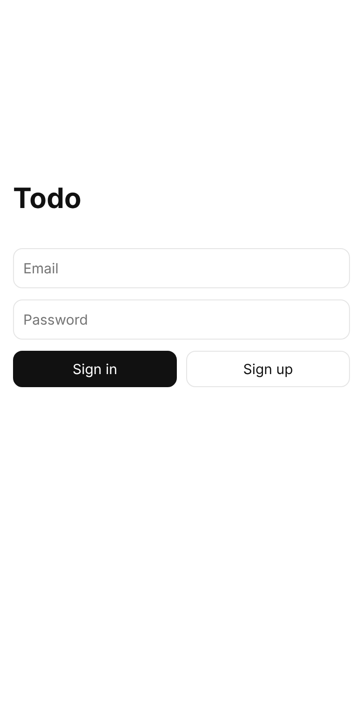
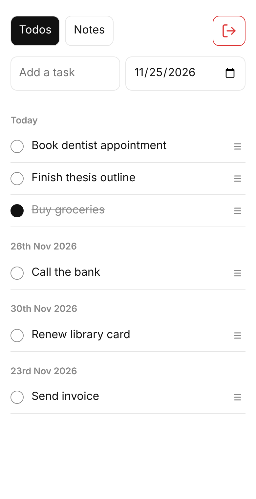
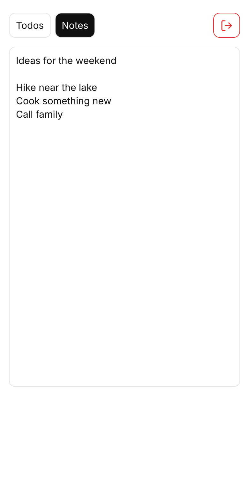

# Todo

A minimal todo and notes app that syncs between a laptop and an iPhone. A personal project. It runs as a web app on GitHub Pages, installs to the home screen, and stores everything in Supabase.

  
  
  

## Features

- Todos grouped by day, with Today always on top
- Drag the handle to reorder or move a task to another day
- Swipe a task left to delete it
- One synced note
- Swipe between the Todos and Notes tabs
- Live sync across devices
- Open tasks for today show on the app icon badge
- Sign in and sign up with email and password

## Files

| File | Purpose |
|---|---|
| `index.html` | Page structure |
| `style.css` | Styling |
| `app.js` | All app logic |
| `sw.js` | Service worker for offline use |
| `manifest.json` | Home screen app settings |
| `setup.sql` | Database table and security rules |

## Security

Every row belongs to one user and row level security means each account only sees its own data. The key in `app.js` is public by design.
